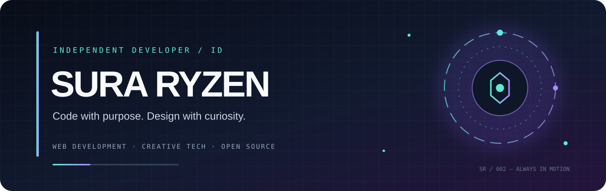

 

  

---

## ✦ 01 / THE PERSON BEHIND THE CODE

Hi, I'm **Sura Ryzen** from **Surabaya, Indonesia** 🇮🇩

I enjoy turning ideas into useful digital experiences. My interests live between software, visual design, and experimenting with technology. I learn by building, breaking things, and making them better.

<b>⚡ A little more about me</b>

 

- 💻 Interested in web and full-stack development
- 🎨 Enjoy UI/UX and visual design
- 🧪 Curious about new tools and creative technology
- 🎮 Outside the editor: anime, gaming, and music

---

## ✦ 02 / THE TOOLBOX

**⌨️ LANGUAGES**

**🧩 FRONTEND**

**⚙️ BACKEND & DATABASE**

**🛠️ WORKBENCH & DESIGN**

---

## ✦ 03 / GITHUB ACTIVITY

  

 

---

## ✦ 04 / CURRENT TRANSMISSION

|  | Building, experimenting, improving |
|:--|:--|
|  | Web apps · Modern tooling · Cloud |
|  | Interesting projects & creative ideas |
|  | Build better things and share more |

---

## ✦ 05 / OUTSIDE THE TERMINAL

*Stories inspire ideas. Games teach systems. Music keeps the flow.*

---

## LET'S BUILD SOMETHING

  

DESIGNED WITH MARKDOWN · SVG · A LITTLE BIT OF MOTION

**Sura Ryzen** · Always curious. Always creating.

